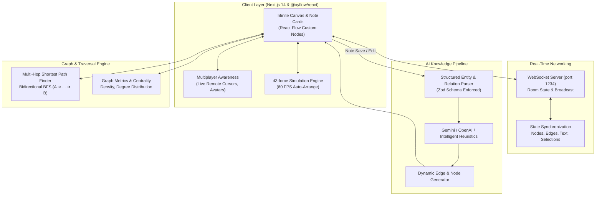

# Synapse: Real-Time Collaborative Knowledge Graph & Canvas

> An interactive, multiplayer workspace (Notion meets Miro) with real-time CRDT synchronization, physics-driven force-directed layouts, and an asynchronous LLM pipeline for dynamic knowledge graph and relationship extraction.

---

## 🌟 Architecture & Core Pillars



---

## 🚀 Key Technical Highlights (Interview Solutions)

### 1. Multiplayer State Synchronization
* **Architecture**: Standalone Node.js WebSocket Room Manager (`server/sync-server.ts`) combined with client awareness channels.
* **Awareness Protocol**: Real-time cursor coordinates `(x, y)` and user presence are broadcast ephemerally to peers without cluttering disk persistence.
* **Canvas Mutations**: Node dragging, addition, deletion, and manual connection handles propagate state updates seamlessly to all connected collaborators.

### 2. Entity & Relation Extraction Pipeline
* **Asynchronous Extraction**: Dispatches analysis jobs on note saves (`src/lib/ai/extractor.ts`).
* **Structured Schemas**: Validated with Zod (`ExtractionResultSchema`) enforcing strict JSON output:
  * Named entities: `concepts`, `services`, `databases`, `APIs`, `people`.
  * Directed typed relationships: `depends_on`, `communicates_with`, `implements`, `stores_in`, `subconcept_of`, `relates_to`.
* **Zero-Friction Fallback**: Includes both Gemini/OpenAI integrations and a zero-config, intelligent heuristic NLP pattern engine (`src/lib/ai/heuristics.ts`) guaranteeing 100% functionality out-of-the-box.
* **Auto-Linker**: Discovered entities and relationships can automatically spawn new nodes and create interactive badge edges on the canvas.

### 3. Graph Traversal & Force-Directed Visualization (60 FPS)
* **Multi-Hop Path Finder**: Bidirectional Breadth-First Search (BFS) engine (`src/lib/graph/traversal.ts`) calculates shortest paths between any two distant systems (e.g. *"How is Next.js Frontend connected to Apache AGE?"*).
* **Canvas Path Highlighting**: Discovered path nodes and connecting edges glow with golden indicators on the canvas with interactive natural language step narratives.
* **Force-Directed Auto-Layout**: Integrated `d3-force` physical simulation (`src/lib/graph/layout.ts`) balancing link attraction and collision repulsion for 60 FPS smooth layout transitions.
* **Dual-View Modes**: Switch effortlessly between **Freeform Spatial Canvas** and **Force-Directed Graph** views.

---

## 📁 Project Structure

```text
Collaborative_Canvas/
├── src/
│   ├── app/
│   │   ├── layout.tsx              # Dark-mode root layout & meta
│   │   ├── page.tsx                # Client Canvas entry point
│   │   ├── globals.css             # Tailwind and React Flow styles
│   │   └── api/
│   │       ├── ai/extract/         # Structured knowledge extraction route
│   │       ├── graph/traversal/    # Multi-hop shortest path API
│   │       └── graph/seed/         # Default architectural knowledge graph
│   ├── components/
│   │   ├── canvas/
│   │   │   ├── CollaborativeCanvas.tsx # Main React Flow canvas with WS hooks
│   │   │   ├── KnowledgeNode.tsx       # Custom node cards with badges & handles
│   │   │   ├── RelationEdge.tsx        # Custom edge with relationship pills
│   │   │   ├── CanvasHeader.tsx        # Room header, view switcher, actions
│   │   │   └── RemoteCursors.tsx       # Real-time multi-collaborator cursors
│   │   ├── graph/
│   │   │   ├── PathFinderModal.tsx     # Multi-hop query dialog & narrative
│   │   │   └── GraphStatsDrawer.tsx    # Density, hubs, degree analytics
│   │   └── editor/
│   │       └── NoteEditorModal.tsx     # Concept note editor & AI extraction trigger
│   └── lib/
│       ├── ai/
│       │   ├── extractor.ts        # LLM structured JSON extractor (Zod)
│       │   └── heuristics.ts       # Intelligent offline NLP pattern extractor
│       └── graph/
│           ├── types.ts            # TypeScript domain interfaces
│           ├── traversal.ts        # BFS multi-hop shortest path & metrics
│           └── layout.ts           # d3-force physical auto-layout engine
├── server/
│   └── sync-server.ts              # Real-time WebSocket CRDT synchronization server
├── scripts/
│   └── test-engine.ts              # Automated verification test suite
└── package.json
```

---

## 🛠️ Quick Start

### 1. Install Dependencies
```bash
npm install
```

### 2. Run Engine Tests
Verify graph traversal, metrics, and entity extraction:
```bash
npx tsx scripts/test-engine.ts
```

### 3. Start Development Servers
Runs both the Next.js frontend (port 3000) and the real-time WebSocket sync server (port 1234) concurrently:
```bash
npm run dev
```

Open [http://localhost:3000](http://localhost:3000) in your browser. You can open multiple browser windows or incognito tabs to test the real-time multiplayer cursors and simultaneous graph updates!

---

## 🔑 Environment Variables (Optional)

Create a `.env.local` file in the root if you want to use external LLM providers:
```env
# Optional: Provide one of the keys for live LLM extraction
GEMINI_API_KEY=your_gemini_api_key_here
# or
OPENAI_API_KEY=your_openai_api_key_here

# WebSocket server port (defaults to 1234)
SYNC_PORT=1234
```
*Note: If no API keys are provided, the built-in intelligent heuristic extractor handles all entity and relation extraction automatically.*
